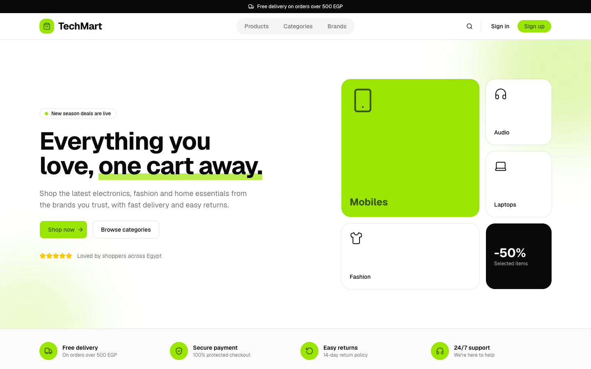
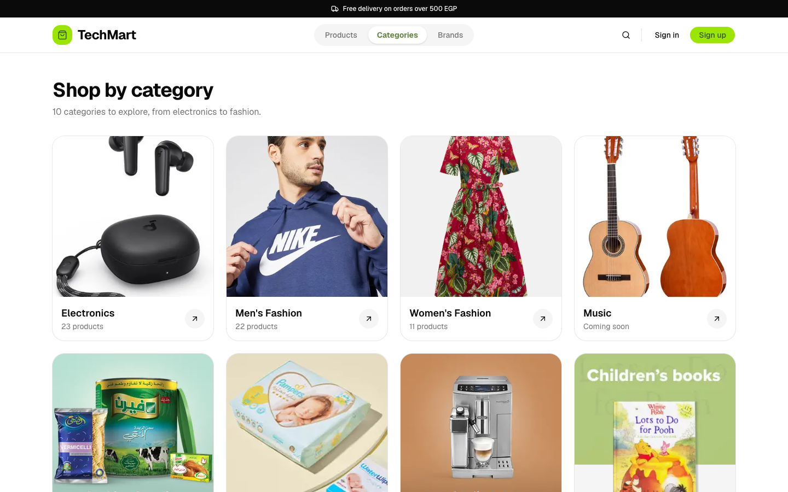
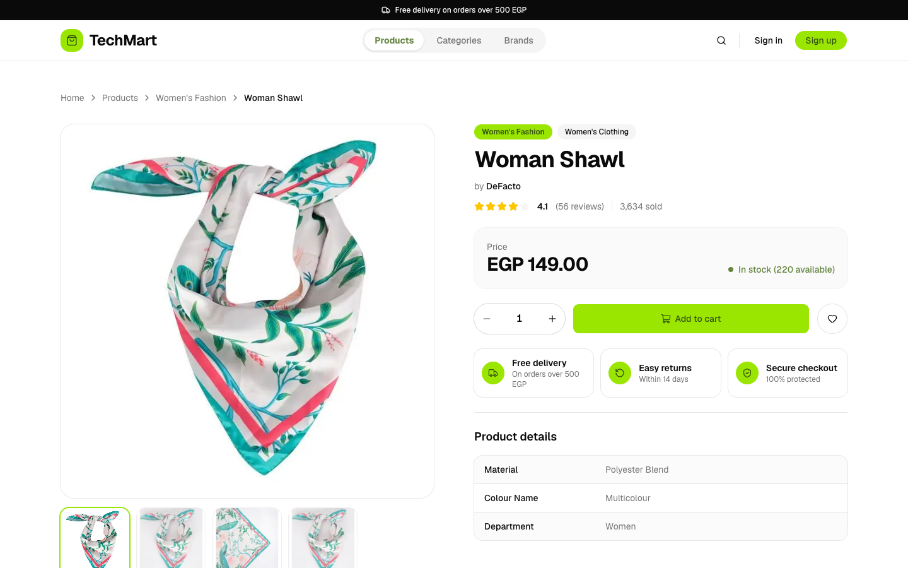
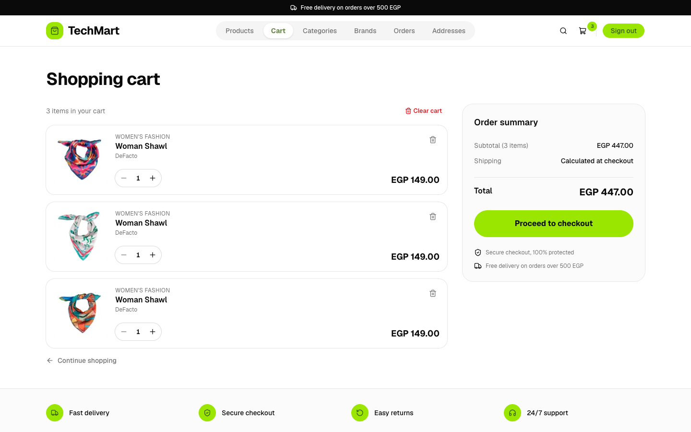
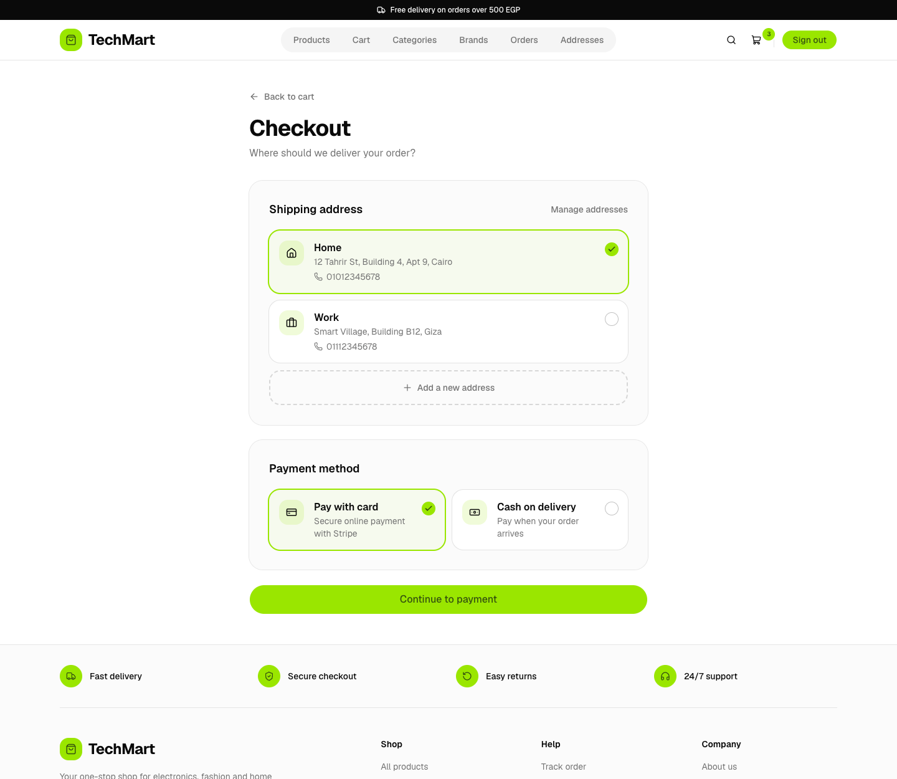
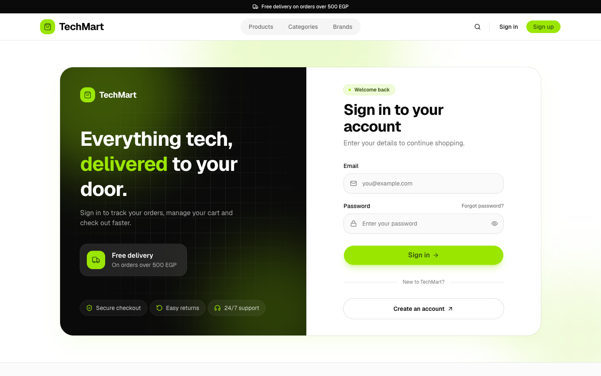
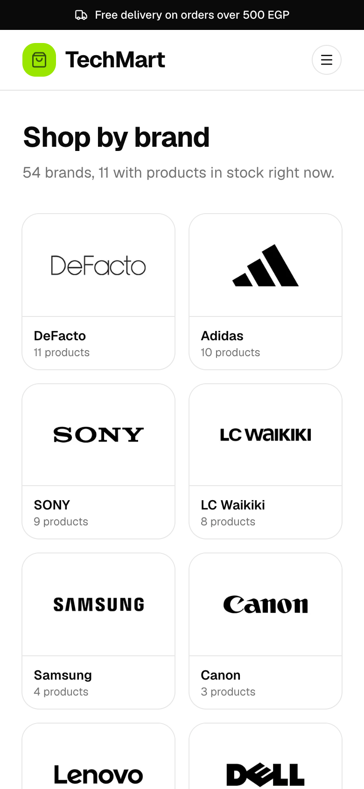

# TechMart

A full-featured e-commerce storefront built with **Next.js 16 (App Router)**, **React 19** and **TypeScript**: browse products by category and brand, manage a cart, save delivery addresses, and check out with card (Stripe) or cash on delivery.




## Screenshots

| Categories | Product details |
| --- | --- |
|  |  |
| **Cart** | **Checkout** |
|  |  |
| **Sign in** | **Mobile** |
|  |  |

## Features

**Shopping**
- Product catalogue with image galleries, ratings and detailed specs
- Categories with subcategory filters, and brands, each with their own product pages
- Cart with quantity controls, remove item and clear cart; the navbar badge updates live

**Accounts**
- Sign in with email and password (NextAuth credentials provider)
- Protected pages (cart, orders, addresses, checkout) redirect to sign in
- Address book: add, edit and delete saved delivery addresses

**Checkout and orders**
- Pick a saved address or add a new one without leaving checkout
- Pay by card through a Stripe checkout session, or choose cash on delivery
- Order history with items, totals, payment method and paid/delivered status

**Experience**
- Responsive layout from phone to desktop
- Loading skeletons for every data page, plus empty states and friendly error messages
- Smooth animations with Framer Motion and toast notifications
- Accessible forms: labelled inputs, inline validation messages, keyboard-friendly selection cards

## Tech stack

| Area | Technology |
| --- | --- |
| Framework | [Next.js 16](https://nextjs.org) (App Router, Server Components, Partial Prerendering) |
| UI | React 19, TypeScript |
| Styling | Tailwind CSS 4, [shadcn/ui](https://ui.shadcn.com) on [Base UI](https://base-ui.com), tw-animate-css |
| Icons and animation | lucide-react, Framer Motion |
| Authentication | NextAuth.js (credentials provider, JWT sessions) |
| Forms and validation | React Hook Form, Zod |
| State | React Context (cart badge), Redux Toolkit store set up for global state |
| Payments | Stripe checkout sessions (created by the backend API) |
| Backend | Route Academy E-commerce REST API (`ecommerce.routemisr.com`) |
| Tooling | ESLint, Turbopack |

## Technical highlights

- **Server-first rendering.** Pages are React Server Components that fetch data on the server. Client Components are used only where there is interaction (cart controls, forms, checkout). With `cacheComponents` enabled, each data page has a `loading.tsx` skeleton that doubles as its Suspense boundary.
- **Authentication and the API token.** NextAuth signs users in against the API. The API token is stored in NextAuth's encrypted JWT cookie through the `jwt` and `session` callbacks. One service class (`src/services/apiServices.ts`) attaches the signed-in user's token to every request: it reads the session with `getServerSession` on the server and `getSession` in the browser.
- **Route protection.** `src/proxy.ts` (Next.js 16's replacement for middleware) redirects signed-out users away from private pages and signed-in users away from the sign-in page.
- **Optimistic cart updates.** Quantity changes show instantly. Rapid clicks are debounced into a single API call, and the item rolls back to the last confirmed quantity if the request fails.
- **Validation where the API has none.** The backend accepts any address, so React Hook Form and Zod schemas validate every field, including Egyptian mobile numbers.
- **Working around API limits.** The API returns at most 50 items per page, so a helper fetches every page in parallel. The address edit endpoint ignores the name field, so renaming saves a new copy before deleting the old one, which means nothing is lost if a request fails.
- **Typed end to end.** Every API response has a TypeScript type in `src/types/response.ts`.

## Project structure

```
src/
├── app/                    # Routes (App Router)
│   ├── (pages)/            # Products, categories, brands, cart
│   ├── addresses/          # Address book
│   ├── allorders/          # Order history
│   ├── checkout/[cartId]/  # Address + payment method selection
│   ├── auth/signin/        # Sign-in page
│   └── api/auth/           # NextAuth route handler
├── components/             # UI by feature: product, cart, checkout, addresses, orders, layout, ui
├── contexts/               # Cart count context
├── lib/                    # NextAuth options, helpers
├── services/apiServices.ts # Every call to the backend API
├── types/                  # API response and NextAuth types
└── proxy.ts                # Route protection
```

## Getting started

**Requirements:** Node.js 20.9 or newer.

```bash
git clone https://github.com/Ahmed-Assem99/Project17-TechMart.git
cd Project17-TechMart
npm install
```

Copy the example environment file and fill in the values:

```bash
cp .env.example .env.local
```

| Variable | Secret? | What it is |
| --- | --- | --- |
| `NEXT_PUBLIC_BASE_URL` | No | Base URL of the e-commerce API |
| `NEXT_PUBLIC_SITE_URL` | No | Address of the site, where Stripe returns customers after payment |
| `AUTH_SECRET` | **Yes** | Encrypts the login cookies. Generate one with `openssl rand -base64 32` |
| `NEXTAUTH_URL` | No | Address of the site (`http://localhost:3000` locally) |

Then start the development server and open [http://localhost:3000](http://localhost:3000):

```bash
npm run dev
```

| Script | What it does |
| --- | --- |
| `npm run dev` | Start the development server |
| `npm run build` | Create a production build |
| `npm run start` | Serve the production build |
| `npm run lint` | Run ESLint |

## Deployment

The app deploys to [Vercel](https://vercel.com) as is. Add the environment variables above in the project settings, with `NEXT_PUBLIC_SITE_URL` and `NEXTAUTH_URL` set to the deployed URL.

## Roadmap

- Sign-up and password reset pages
- Product search, sorting and price filters
- Wishlist
- Automated tests

## Acknowledgements

Product data, authentication, cart, orders and payments are provided by the Route Academy E-commerce API.

## Author

**Ahmed El Fakharany**, [GitHub](https://github.com/Ahmed-Assem99)
